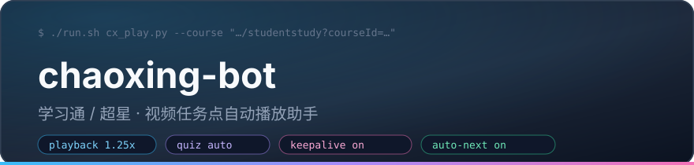

<div align="center">
  
</div>

# chaoxing-bot · 学习通自动播放助手

[](https://github.com/hongnuanhu/chaoxing-bot/actions/workflows/ci.yml)


自动播完学习通（超星）视频任务点：**自动播放、静音、倍数锁定、弹题自动作答、播完自动下一节、挂机保活**，
另附一条「直发进度上报」的进阶路线，用来补看或省流量。

三种用法，按你的情况选一条就行 —— **不用写代码，照着复制命令**。

| 你想要 | 走哪条路 | 需要什么 | 花多久 |
|---|---|---|---|
| 打开课程让它自己播，我在旁边干别的 | [路线一 · 浏览器脚本](#路线一浏览器脚本零环境3-分钟) | 一个浏览器 + 一个扩展 | 3 分钟 |
| 关掉窗口前挂上，整门课自动跑完切下一节 | [路线二 · 全自动](#路线二全自动跑整门课python10-分钟) | 装一次 Python 环境 | 10 分钟 |
| 只想补几分钟进度 / 不想真播 | [路线三 · 直发上报](#路线三直发进度上报进阶) | 路线二的环境 + 一点抓包 | 20 分钟 |

> 只在**你自己的账号、你自己选的课**上用。运行后会生成含登录 cookie 的本地文件，处置方式见 [SECURITY.md](SECURITY.md)。

---

## 目录

- [它能做什么](#它能做什么)
- [路线一：浏览器脚本（零环境，3 分钟）](#路线一浏览器脚本零环境3-分钟)
- [路线二：全自动跑整门课（Python，10 分钟）](#路线二全自动跑整门课python10-分钟)
- [路线三：直发进度上报（进阶）](#路线三直发进度上报进阶)
- [参数手册](#参数手册)
- [它到底怎么工作的](#它到底怎么工作的)
- [常见问题](#常见问题)
- [安全与隐私](#安全与隐私)
- [仓库结构](#仓库结构)
- [开发与测试](#开发与测试)
- [License](#license)

---

## 它能做什么

| 能力 | 说明 |
|---|---|
| 自动播放 | 进入课程页就接管播放器，弹出「继续播放」也能自动点掉 |
| 静音 | 默认静音，多开标签页不会互相盖声音 |
| 倍数锁定 | 默认 1.25x；播放器把自己改回去后，脚本立刻纠正回来 |
| 弹题自动作答 | 视频中途弹题是常见卡点，脚本识别后自动选第一项、提交、关面板，题目文本写进日志 |
| 播完自动下一节 | 本节播完自动点「下一节」/ 下一个未完成任务点，15s 冷却防连点 |
| 挂机保活 | 每 30s 轻微回拨 `currentTime`，避免「长时间无进度」被判掉 |
| 后台伪装 | 切标签页 / 切窗口不会让视频暂停 |
| 断点续跑 | 跑过的课程记进 `progress.json`，下次自动跳过 |
| 进度直发（进阶） | 用抓到的 `enc` 公式直接发上报请求，可指定播放到第几秒 |

**不做的事**：不代做章节测验、不刷讨论、不改成绩、不碰别人的账号。

---

## 路线一：浏览器脚本（零环境，3 分钟）

最省事的一条，适合 90% 的人。全程在浏览器里点。

### 1. 装一个用户脚本管理器

选你顺手的浏览器，装对应的扩展（商店里搜名字即可）：

| 浏览器 | 扩展 |
|---|---|
| Chrome / Edge | **Tampermonkey**（篡改猴） |
| Firefox | **Tampermonkey** 或 **Violentmonkey** |
| Safari | **Tampermonkey**（App Store 安装，装完到 设置 → 扩展 里勾选） |

### 2. 安装脚本

在**已登录 GitHub 的浏览器**里打开这个链接，Tampermonkey 会自动弹出安装页，点 **安装**：

```
https://raw.githubusercontent.com/hongnuanhu/chaoxing-bot/main/cx.user.js
```

装好后扩展图标上会出现数字 1，说明脚本已就位。

### 3. 打开课程，看它自己跑

1. 浏览器登录学习通，进入 **我学的课 → 某门课**
2. 点开任意一节有视频的章节
3. 视频应该在 2 秒内自动开始播放，且**是静音的**

按 `F12` 打开控制台，能看到脚本实时汇报：

```
[CX 21:04:11] bot ready @ https://mooc1-1.chaoxing.com/ananas/modules/video/index.html...
[CX 21:04:12] 找到视频, duration= 623.4
[CX 21:04:44] keepalive t= 41 / 623
[CX 21:05:30] 【自动答】弹题: 下列关于…的说法正确的是  选项数= 4
[CX 21:05:31] 已提交答案: B
[CX 21:06:20] 视频播放结束
[CX 21:06:23] 点击下一节: .next
```

随时可以在控制台查历史日志：

```js
window.__CX_LOGS__          // 最近 500 条
```

### 4. 想改默认行为

点 Tampermonkey 图标 → 找到 `超星学习通 自动刷课助手` → **编辑** → 改文件顶部的 `CFG`：

```js
const CFG = {
  rate: 1.25,          // 倍数，1~1.5 最稳，2 以上容易判异常
  mute: true,          // 静音
  autoNext: true,      // 播完自动下一节
  quizMode: 'auto',    // 'auto' 自动答 / 'pause' 弹题就暂停等你人工答
  quizPick: 0,         // 自动答选第几个选项（0=第一个）
  keepAlive: true,     // 挂机保活
  keepAliveMs: 30000,  // 保活间隔
  tickMs: 1500,        // 主循环间隔
  debug: true,         // 控制台打印
};
```

改完 `Cmd/Ctrl + S` 保存，刷新课程页生效。

> 弹题答错会扣分。在意这点就把 `quizMode` 改成 `'pause'`：脚本只暂停 + 在控制台打出题目，答案你自己点，选完自动继续。

---

## 路线二：全自动跑整门课（Python，10 分钟）

适合：课程多、章节碎、你想关掉窗口干别的事。这条路用真浏览器驱动，登录一次，之后整门课自动跑完、自动切下一章。

### 1. 装环境（三平台选一段）

**macOS / Linux**

```bash
git clone https://github.com/hongnuanhu/chaoxing-bot.git
cd chaoxing-bot
python3 -m venv .venv
.venv/bin/pip install -r requirements.txt
.venv/bin/python -m playwright install chromium
chmod +x run.sh
```

**Windows（PowerShell 或 CMD）**

```powershell
git clone https://github.com/hongnuanhu/chaoxing-bot.git
cd chaoxing-bot
py -3 -m venv .venv
.venv\Scripts\python.exe -m pip install -r requirements.txt
.venv\Scripts\python.exe -m playwright install chromium
```

没装 git？在仓库页点 **Code → Download ZIP** 解压，从 `cd` 那步开始。
没装 Python？<https://www.python.org/downloads/> 装 3.9+，Windows 安装时**勾选 Add Python to PATH**。

### 2. 自检（不需要账号，纯本地）

```bash
# macOS / Linux
.venv/bin/python tests/test_userscript.py

# Windows
.venv\Scripts\python.exe tests\test_userscript.py
```

看到 `结果: 全部通过` 就说明环境和脚本都正常。它会起一个本地假播放器跑 10 项断言，不联网。

### 3. 登录一次

```bash
# macOS / Linux
./run.sh cx_play.py --login

# Windows
run.cmd cx_play.py --login
```

会弹出真的 Chromium 窗口，在里面扫码或输入账号密码登录，登录完回终端按 **回车**。登录态存进 `cx_profile/`，以后不必重复登录。

### 4. 复制课程链接

浏览器打开课程，地址栏长这样，整条复制：

```
https://mooc1-1.chaoxing.com/mycourse/studentstudy?courseId=240000001&clazzid=80000001&enc=9f8c...
```

### 5. 开跑

```bash
# macOS / Linux
./run.sh cx_play.py --course "上面那条URL"

# Windows
run.cmd cx_play.py --course "上面那条URL"
```

终端实时滚动：

```
▶  42.7%    256.3/600.0s  rate=1.25  quiz=False
✔ 第 1 个视频播放完毕
第 3 轮结束，切换下一个任务点 → .next
```

一门课跑完自动切章节；结束的课程写进 `progress.json`，下次自动跳过。

### 6. 多门课一起排

```bash
cp urls.txt.example urls.txt      # Windows: copy urls.txt.example urls.txt
# 把每门课的 URL 一行一条填进 urls.txt
./run.sh cx_play.py --list urls.txt
```

串行跑，不会同时开多个账号会话。

### 7. 常用加餐参数

```bash
./run.sh cx_play.py --course "URL" --rate 1.0        # 保守倍速，最不容易被判异常
./run.sh cx_play.py --course "URL" --quiz pause      # 弹题暂停，等我自己答
./run.sh cx_play.py --course "URL" --channel chrome  # 用本机 Chrome，指纹更像真人
./run.sh cx_play.py --course "URL" --keep-open       # 跑完不关窗，方便检查
```

---

## 路线三：直发进度上报（进阶）

适合：只想补几分钟进度，或反复卡在某一节看不动。**前提是你能从页面拿到 `enc` 公式**，否则用路线一/二。

原理一句话：上报请求带 `enc = md5(一串拼接字段)`，拼错一个字就判无效。所以先用工具把公式挖出来，再按段发送。

### 1. 采集真实样本（开播放器跑 3 分钟）

```bash
./run.sh cx_report.py probe --course "课程URL" --seconds 180
```

产出 `enc_samples.json`：每条上报的完整 query 字段 + 当前 cookie。终端会打印字段表：

```
   clazzid      = 80000001
   userid       = 12345678
   jobid        = work-1234567
   objectId     = 0
   playingTime  = 45000
   duration     = 623
   d            = d_yi
   enc          = a1b2c3...
```

### 2. 从页面 JS 里挖出拼接顺序

```bash
./run.sh cx_report.py grab-js --course "课程URL"
```

把课程页加载的所有脚本下载到 `js_dump/`，并打印含 `enc` / `md5` / `playingTime` 的可疑行，拼接顺序就在里面。

### 3. 填公式 → 干跑 → 真发

`enc_spec.json`：

```json
{
  "template": "{clazzid}[{userid}][{jobid}][{objectid}][{playing_ms}][{d}][{duration}]",
  "playing_unit": "s",
  "dry": true,
  "tasks": [
    { "jobid": "work-1234567", "objectid": "0", "clazzid": "80000001",
      "userid": "12345678", "duration": 623, "step": 60, "sleep": 1.0 }
  ]
}
```

```bash
./run.sh cx_report.py run --spec enc_spec.json          # dry=true 只打印生成的 URL
# 确认 playingTime / enc 与样本对得上后，把 dry 改成 false 再跑
```

返回 `{"isPassed":true}` 即成功；`false` 说明拼串顺序、单位（秒 vs 毫秒）或 cookie 有问题。

> 这条路能用但脆——平台改一次前端就可能失效。日常还是走路线一/二。

---

## 参数手册

### 命令行（`cx_play.py`）

| 参数 | 默认 | 说明 |
|---|---|---|
| `--login` | — | 只做登录，把登录态存进 `cx_profile/` |
| `--course URL` | — | 单个课程学习页地址 |
| `--list FILE` | — | 每行一个 URL 的列表文件 |
| `--rate N` | `1.25` | 播放倍数，建议 1~1.5 |
| `--quiz auto\|pause` | `auto` | 弹题策略 |
| `--minutes N` | 不限 | 单课程最多跑多少分钟 |
| `--max-rounds N` | `200` | 最多切多少个任务点 |
| `--channel chrome` | 空 | 用本机 Chrome 而非内置 Chromium |
| `--keep-open` | 关 | 跑完不关浏览器 |

### 脚本内（`cx.user.js` 顶部 `CFG`）

见[路线一第 4 步](#4-想改默认行为)，字段与上表对应，另有 `keepAliveMs`、`tickMs`、`debug`。

### 直发（`enc_spec.json`）

| 字段 | 说明 |
|---|---|
| `template` | enc 拼接模板，占位符见文件内注释 |
| `playing_unit` | `s` 或 `ms`，决定 `playingTime` 单位 |
| `dry` | `true` 只打印生成的 URL，不发请求 |
| `tasks[].step` | 每次上报前进多少秒 |
| `tasks[].sleep` | 两次上报间隔秒数，别设太小 |

---

## 它到底怎么工作的

看懂这段，出问题你自己就能定位。

学习通的视频进度**不是点一下就完成的**，播放器在播放过程中不断给服务端发心跳：

```
GET /multimedia/log/a/{clazzid}/{userid}
    ?jobid=…&objectId=…&playingTime=…&duration=…&d=d_yi&enc=<md5>
```

- `playingTime` 是「已播放到第几毫秒」，服务端拿它和上一笔比较算增量
- `enc` 是前端把若干字段拼成一串再做 md5，服务端用同样规则重算，不一致就丢
- 服务端还会看**增量与真实时间间隔是否匹配**——这就是 2 倍速以上容易失效的原因
- 长时间没有新心跳，这一节会被判「未完成」

所以本项目的主策略是**不伪造请求，而是把页面驱动起来**：真播放、真心跳、`enc` 由页面自己算。
路线一/二都是这个思路，只有路线三才去碰 `enc` 公式。更细的机制见 [docs/how-it-works.md](docs/how-it-works.md)。

---

## 常见问题

<details>
<summary><b>视频不动 / 一直显示「… 等待播放器」</b></summary>

先确认是不是非视频任务点（音频、文档、PPT）。视频的话用 `--keep-open` 打开窗口、按 F12 看视频到底在哪个 iframe 里；有些老课程用 `ans.Drag` 播放器，把 `rate` 改成 `1.0` 再试。
</details>

<details>
<summary><b>进度条在走，但任务点不变绿</b></summary>

上报被服务端拒了。依次查：`rate` 是不是太高（先降到 1.0）、这一节有没有前置条件（章节测验 / 讨论没做）、cookie 是否过期（重跑 `--login`）。也可以用路线三的 `probe` 抓一条真实上报，对比提交的 `duration` / `playingTime` 是否一致。
</details>

<details>
<summary><b>倍数开到 2 会不会更快</b></summary>

会更快，也更容易被判无效。平台比对「增量 / 真实间隔」，1.5 以上风险明显上升。真要快就用 `--rate 1.5`，别长期这么跑。
</details>

<details>
<summary><b>弹题答错扣分怎么办</b></summary>

把 `quizMode` 改成 `'pause'`（或命令行 `--quiz pause`）。脚本会在弹题出现时暂停并在日志里打出题目，答案你自己选，选完自动继续。
</details>

<details>
<summary><b>能同时跑几个账号 / 几门课</b></summary>

一门一门来。多账号并发登录会互相踢下线，进度可能清零。`--list` 本身就是串行的，安全。
</details>

<details>
<summary><b>Windows 报错 <code>python 不是内部或外部命令</code></b></summary>

装 Python 时没勾 Add to PATH。重装勾上，或用 `py -3` 代替 `python`。
</details>

<details>
<summary><b>macOS 提示 <code>chromium 已损坏 / 无法验证开发者</code></b></summary>

```bash
xattr -cr ~/Library/Caches/ms-playwright
```
再跑一次 `python -m playwright install chromium`。
</details>

<details>
<summary><b>登录态过期了</b></summary>

删掉 `cx_profile/` 重新 `--login`。别把 `cx_profile/` 提交到任何仓库——它等于你的登录凭据。
</details>

<details>
<summary><b>能不能用 Safari / 手机</b></summary>

Safari 可以装 Tampermonkey，脚本能跑。iOS / Android 浏览器装不了用户脚本，手机端建议改用电脑跑路线二。
</details>

<details>
<summary><b>跑完发现还有几节没完成</b></summary>

删掉 `progress.json` 里对应条目，或整门重跑一次——脚本只补没完成的，已完成的任务点不会重复消耗时间。
</details>

更多问答见 [docs/faq.md](docs/faq.md)，卡住了看 [docs/troubleshooting.md](docs/troubleshooting.md)。

---

## 安全与隐私

| 你会生成的东西 | 里面有什么 | 怎么处理 |
|---|---|---|
| `cx_profile/` | 浏览器用户数据，含学习通登录 cookie | **等于你账号的钥匙**，绝不外传、绝不提交 |
| `enc_samples.json` | 上报 URL（含 uid、enc）+ cookie | 用完即删 |
| `urls.txt` | 你的真实课程链接 | 已在 `.gitignore` 里 |
| `progress.json` | 你的学习进度 | 同上 |

仓库本身不含任何凭据。提交前自检、历史清理、密钥保管的完整流程见 [SECURITY.md](SECURITY.md)。

---

## 仓库结构

```
.
├── cx.user.js                 # 核心：用户脚本（Tampermonkey / Playwright 注入通用）
├── cx_play.py                 # 路线二：Playwright 启动器 + 进度盯盘
├── cx_report.py               # 路线三：直发上报 + enc 公式提取
├── run.sh / run.cmd           # macOS·Linux / Windows 统一入口
├── requirements.txt           # playwright + requests
├── enc_spec.json              # 路线三配置模板
├── urls.txt.example           # 批量课程列表格式
├── assets/banner.svg          # README 顶图
├── docs/
│   ├── how-it-works.md        # 进度上报机制详解
│   ├── troubleshooting.md     # 排查手册（长版）
│   └── faq.md                 # 更多问答
├── tests/test_userscript.py   # 离线行为测试（10 项断言）
├── SECURITY.md                # 凭据处置
└── .github/workflows/ci.yml   # 语法检查 + 行为测试
```

---

## 开发与测试

```bash
# macOS / Linux
.venv/bin/python tests/test_userscript.py

# Windows
.venv\Scripts\python.exe tests\test_userscript.py
```

测试会在本地起一个假播放器（无网络、无账号），验证：视频发现、倍数锁定、静音、被改回倍数后自愈、弹题自动提交、播完点下一节、visibility 伪装。CI 每次 push 都会跑一遍。

流程：改 `cx.user.js` → 跑测试 → 提 PR。

---

## License

[MIT](LICENSE) · 仅供学习自动化技术、处理自己已选课程使用。
